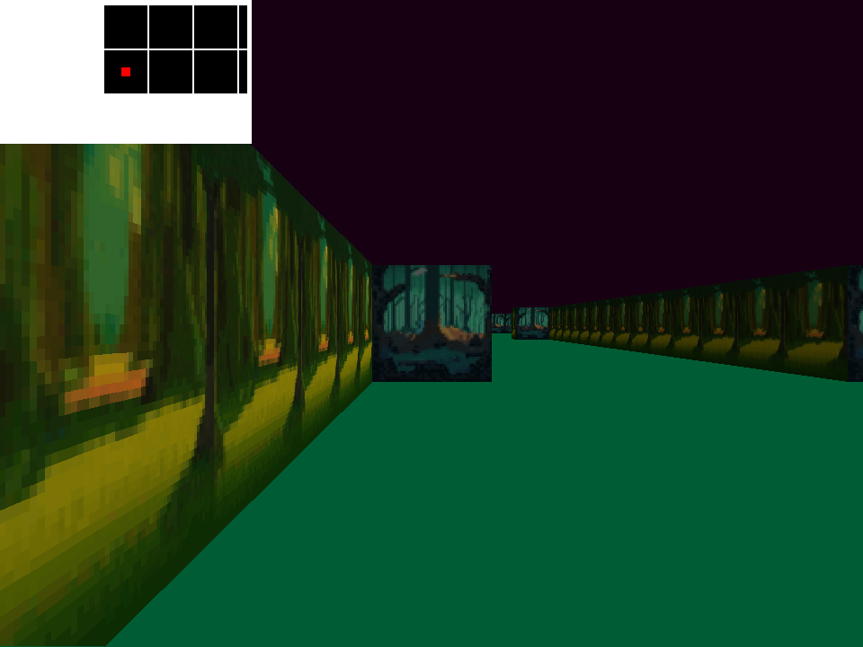
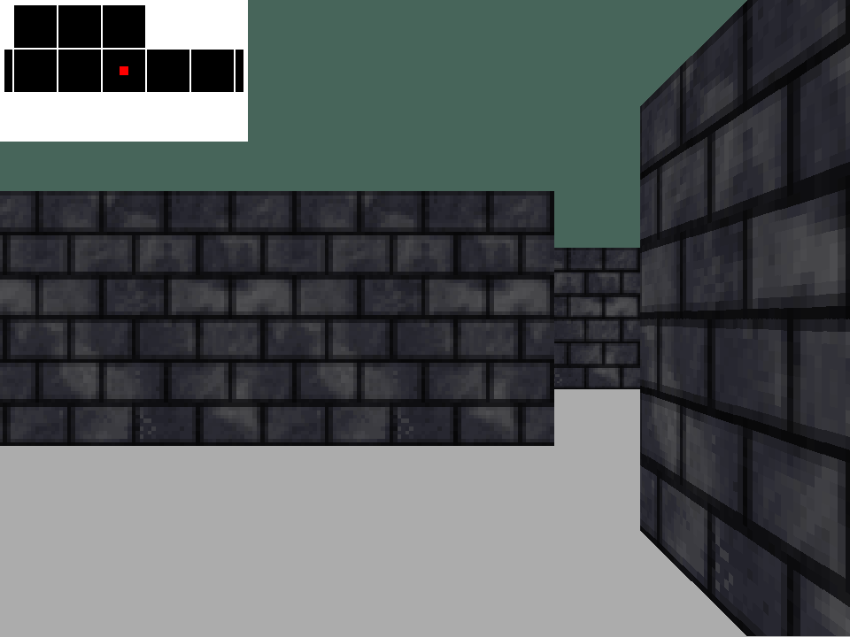
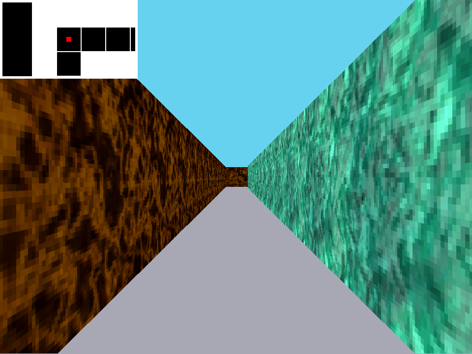
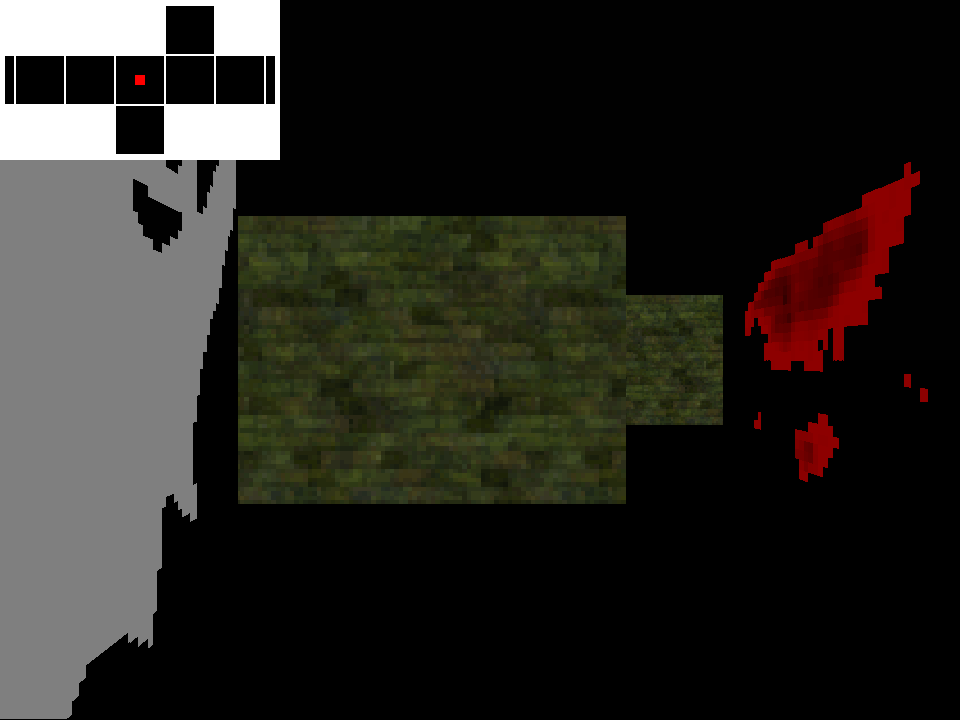
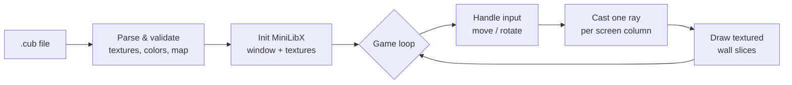

<div align="center">

# cub3D

**A first-person 3D raycasting engine written in C with MiniLibX**

Turns a 2D grid map into a textured, real-time 3D world using the DDA raycasting algorithm.




</div>

---

## Table of Contents

- [About](#about)
- [Features](#features)
- [Gallery](#gallery)
- [Installation](#installation)
- [Usage](#usage)
- [Map Format](#map-format)
- [How It Works](#how-it-works)
- [Project Structure](#project-structure)
- [Error Handling & Testing](#error-handling--testing)
- [Resources](#resources)
- [Author](#author)

---

## About

**cub3D** is a 3D raycasting engine that recreates a classic first-person 3D game environment from a simple 2D map. It is part of the [42 School](https://www.42network.org/) common core.

The engine reads a `.cub` scene file that describes wall textures, floor and ceiling colors, and a grid map. It validates the file, then renders a perspective view in real time. For each vertical column of the screen it casts one ray through the grid until the ray hits a wall, and uses the distance to decide how tall that slice of wall should be drawn.

The whole project is written in C, with no game engine and no 3D library. It uses only [MiniLibX](https://github.com/42Paris/minilibx-linux), a thin wrapper over X11 that opens a window, pushes pixels and receives input events. Everything else is built from scratch: parsing, validation, raycasting, texture mapping, movement and memory management.

## Features

### Mandatory

- Real-time first-person rendering using **DDA raycasting**
- **Textured walls**, with a different texture for each compass direction (North, South, East, West)
- Configurable **floor and ceiling colors** (RGB)
- Directional **shading**: North and East faces are darkened to add depth
- Smooth movement (**W A S D**) and camera rotation (**← →**)
- Strict `.cub` **parser and validator** with explicit error messages
- Clean exit on **ESC** or the window close button, with all memory freed

### Bonus

- **Wall collisions**: the player can no longer walk through walls
- **Minimap** in the top-left corner, centered on the player
- **Mouse look**: rotate the camera by moving the mouse, with the cursor wrapping at the window edges

## Gallery

| Brick dungeon | Tight corridors | Horror scene |
|:---:|:---:|:---:|
|  |  |  |

## Installation

### Requirements

- Linux with an X11 display (WSL2 with WSLg works too)
- `gcc` and `make`
- X11 and XShm development headers, plus `libbsd`, all required by MiniLibX

On Debian or Ubuntu:

```bash
sudo apt-get update
sudo apt-get install gcc make xorg libx11-dev libxext-dev libbsd-dev
```

### Build

```bash
git clone https://github.com/rasiolisufaj/42-cub3D.git
cd 42-cub3D
make            # mandatory version
make bonus      # bonus version (minimap, collisions, mouse look)
```

MiniLibX and `libft` are bundled in the repository and are built automatically.

| Command       | Description                                       |
|---------------|---------------------------------------------------|
| `make`        | Build the mandatory `cub3D` executable            |
| `make bonus`  | Rebuild `cub3D` with the bonus features enabled   |
| `make clean`  | Remove object files                               |
| `make fclean` | Remove object files and the executable            |
| `make re`     | Full rebuild (also switches back from bonus)      |

## Usage

```bash
./cub3D <path/to/map.cub>
```

For example:

```bash
./cub3D maps/good_maps/map1.cub
./cub3D maps/good_maps/horror_scene.cub
```

### Controls

| Key / Input             | Action                      |
|-------------------------|-----------------------------|
| `W` / `S`               | Move forward / backward     |
| `A` / `D`               | Strafe left / right         |
| `←` / `→`               | Rotate camera left / right  |
| Mouse movement *(bonus)* | Rotate camera              |
| `ESC` or window ✕       | Quit                        |

## Map Format

A scene is described in a plain-text `.cub` file. Here is a minimal valid example:

```text
NO textures/test/north.xpm
SO textures/test/south.xpm
WE textures/test/west.xpm
EA textures/test/east.xpm

F 220,100,0
C 225,30,0

111111
100101
101001
1100N1
111111
```

### Elements

| Identifier | Meaning               | Value                              |
|------------|-----------------------|------------------------------------|
| `NO`       | North wall texture    | Path to a `.xpm` file (64×64)      |
| `SO`       | South wall texture    | Path to a `.xpm` file (64×64)      |
| `WE`       | West wall texture     | Path to a `.xpm` file (64×64)      |
| `EA`       | East wall texture     | Path to a `.xpm` file (64×64)      |
| `F`        | Floor color           | `R,G,B`, each value in `0–255`     |
| `C`        | Ceiling color         | `R,G,B`, each value in `0–255`     |

### Map characters

| Char                  | Meaning                                         |
|-----------------------|-------------------------------------------------|
| `1`                   | Wall                                            |
| `0`                   | Empty floor                                     |
| `N` `S` `E` `W`       | Player spawn point and the direction it faces   |
| ` ` (space)           | Void; spaces inside the map are treated as wall |

### Rules

- The six elements can appear in any order, separated by empty lines, but they must all come **before** the map.
- The map must be the **last** element in the file.
- There must be **exactly one** player spawn point.
- The map must be **closed**: every floor tile must be surrounded by walls, with no gap leading into the void.
- The map must be at least 3 rows high.

## How It Works



### 1. The camera

The player has a **position**, a **direction vector** and a **camera plane** perpendicular to it. The plane length of `0.66` gives a field of view of about 66°. For every screen column `x`, the ray direction is:

```text
camera_x = 2 * x / WIDTH - 1          // -1 (left edge) … +1 (right edge)
ray_dir  = dir + plane * camera_x
```

### 2. DDA (Digital Differential Analysis)

Instead of moving along the ray in small fixed steps, DDA jumps **from one grid line to the next**. At each step it advances along whichever axis (X or Y) has the closer next grid boundary. It stops when it reaches a cell containing a wall. This finds the exact wall hit in very few iterations.

### 3. Wall height

The engine uses the **perpendicular** distance to the camera plane, not the Euclidean distance, which avoids the fish-eye effect. The projected height of the wall slice is inversely proportional to that distance:

```text
line_height = SCREEN_HEIGHT / perp_wall_dist
```

### 4. Texture mapping

The exact hit point along the wall (`wall_x`) selects the **texture column**. The engine then walks down the slice, stepping through the texture rows in proportion to the slice height. The texture is chosen from the side of the wall that was hit and the ray's direction (N, S, E or W). Pixels that are not wall are filled with the ceiling color above the horizon and the floor color below it.

## Project Structure

```text
42-cub3D/
├── includes/
│   └── cub3d.h              # Structs, constants, error messages, prototypes
├── sources/
│   ├── main.c               # Entry point
│   ├── error.c              # Error reporting
│   ├── parsing/             # .cub reading, element parsing, map validation
│   ├── init/                # Data, MiniLibX and texture initialization
│   ├── movement/            # Input hooks, movement, rotation, collisions
│   ├── render/              # Raycasting, texturing, frame and minimap drawing
│   └── exit/                # Cleanup and memory release
├── maps/
│   ├── good_maps/           # Valid scenes to play
│   └── bad_maps/            # Invalid scenes that test the validator
├── textures/                # 64×64 XPM wall textures
├── libft/                   # Custom C standard library (incl. get_next_line)
├── minilibx-linux/          # MiniLibX graphics library
└── Makefile
```

## Error Handling & Testing

Invalid input is rejected cleanly. When anything is wrong with the arguments or the scene file, the program prints `Error` followed by an explicit message, frees everything it allocated and exits with status `1`:

```text
$ ./cub3D maps/bad_maps/map_not_closed.cub
Error
maps/bad_maps/map_not_closed.cub: Map is not enclosed by walls
```

Detected problems include:

- a wrong argument count, a missing file, a directory, or a file without the `.cub` extension
- missing, duplicated or unknown identifiers
- a texture file that doesn't exist, isn't a `.xpm` file, or isn't 64×64
- RGB values that are malformed or out of the `0–255` range
- an invalid character in the map, zero or several spawn points, or a map that is open or too small
- any content found after the map

Run the whole invalid-map suite with:

```bash
for map in maps/bad_maps/*.cub; do ./cub3D "$map"; echo; done
```

To check for memory errors and leaks:

```bash
valgrind --leak-check=full ./cub3D maps/good_maps/map1.cub
```

## Resources

- [Lode's Computer Graphics Tutorial: Raycasting](https://lodev.org/cgtutor/raycasting.html), the reference for the DDA approach used here
- [MiniLibX for Linux](https://github.com/42Paris/minilibx-linux)
- [A first-person engine in 265 lines](https://www.playfuljs.com/a-first-person-engine-in-265-lines/), an accessible introduction to raycasting

## Author

**Rasiol Isufaj** ([@rasiolisufaj](https://github.com/rasiolisufaj)), 42 login `raisufaj`

<div align="center">

If you found this project useful or interesting, consider giving it a ⭐

</div>
